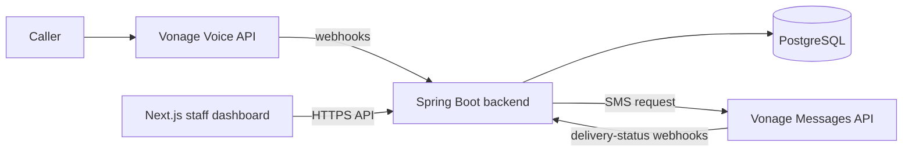

# Architecture

This is a high-level view of the agreed MVP architecture. It describes boundaries and responsibilities, not unverified Vonage API contracts or the final data model.

## Overview

## Responsibilities

| Component | Responsibility |
| --- | --- |
| Vonage Voice API | Receives the reservation call and exchanges call events with the backend. |
| Spring Boot backend | Applies reservation rules, validates capacity, persists confirmed reservations, receives webhooks, and requests notifications. |
| PostgreSQL | Stores the data required by the MVP, including reservations and notification status. The detailed data model remains pending. |
| Vonage Messages API | Requests SMS confirmations after a reservation has been persisted. |
| Next.js dashboard | Lets staff view capacity and reservations and create manual reservations through the backend API. |

## Security boundaries

- Vonage credentials, database credentials, and webhook validation configuration belong only in backend or local-environment configuration; they must never reach the browser or the repository.
- The dashboard must use the backend for reservation creation and capacity calculation. It must not reproduce or bypass business rules in the browser.
- Webhook payloads and delivery states must be verified against current official Vonage documentation before implementation.

## Confirmed technology choices

The agreed implementation stack is Java 21, Spring Boot, Maven, PostgreSQL, Spring Data JPA / Hibernate, Flyway, Next.js, Tailwind CSS, Docker, Docker Compose, and Testcontainers for integration tests. See [ADR-001](adr/001-initial-technology-stack.md).

## Decisions still open

- Customer data model and business-duplicate behaviour.
- Exact API endpoints, webhook payloads, authentication, and Spanish speech-recognition behaviour.
- Version selection, deployment, CI, and the detailed repository structure.
