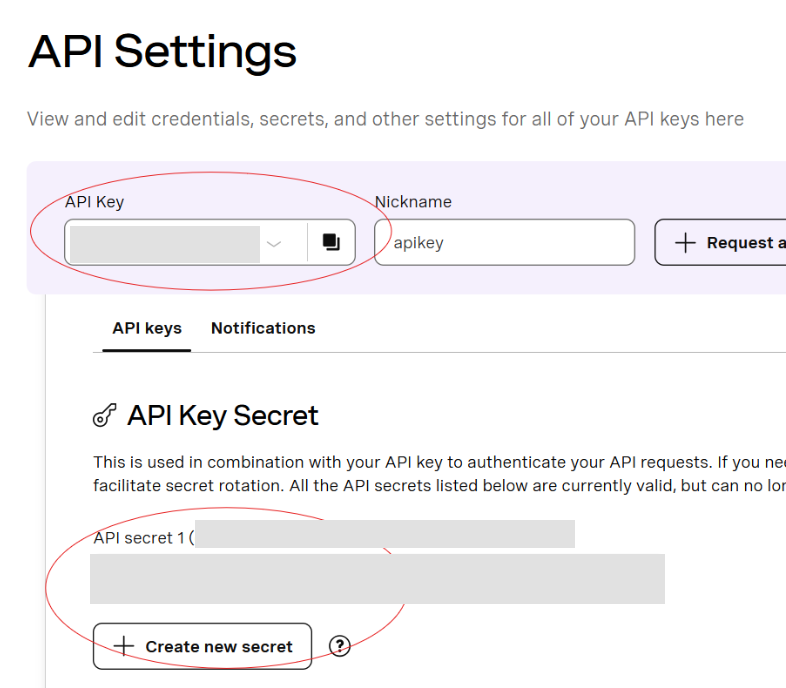

# Vonage MCP and CLI setup

This guide covers local developer tools for issue #27, not the application runtime. Each teammate configures them on her own machine with her own Vonage account. Never share or commit credentials.

The API key and secret are account-level credentials. The key/secret from your training demo belong to the account you used there; they are not team credentials. A future project account will have its own. Neither tool loads credentials from the project's `.env`; configure each one as described below.

## 1. Configure the Vonage MCP server

There is no universal MCP config file. Each client keeps its own, but the server entry is identical everywhere; only the location and syntax change.

| Client | Personal configuration file | Format |
| --- | --- | --- |
| GitHub Copilot CLI | `~/.copilot/mcp-config.json` (`COPILOT_HOME` overrides the directory) | JSON, top-level `mcpServers` |
| VS Code with the Copilot harness | Same `~/.copilot/mcp-config.json` | JSON, top-level `mcpServers` |
| Claude Code | `~/.claude.json`, written by `claude mcp add --scope user` | JSON, `mcpServers` entry |
| Codex CLI | `~/.codex/config.toml` | TOML, `[mcp_servers.<name>]` table |
| OpenCode | `~/.config/opencode/opencode.json` | JSON, `mcp.servers` |

Do not add a repository-root `.mcp.json`, `.vscode/mcp.json`, `.codex/config.toml`, or any other project-scoped MCP file. Claude Code and Codex CLI both offer project scope and VS Code offers a workspace file, but MCP configuration stays personal here so credentials never reach source control. For an unlisted client, use its own setup flow with the same entry; see Vonage's [Tooling MCP installation guide](https://developer.vonage.com/en/mcp-server/how-to-guides/install-tooling-mcp-server).

### The server entry

All clients start `@vonage/vonage-mcp-server-api-bindings` over stdio with `npx`. Fill in your account key and secret; keep the other values empty.

```json
{
  "vonage-mcp-server-api-bindings": {
    "type": "stdio",
    "command": "npx",
    "args": ["-y", "@vonage/vonage-mcp-server-api-bindings"],
    "env": {
      "VONAGE_APPLICATION_ID": "",
      "VONAGE_PRIVATE_KEY64": "",
      "VONAGE_API_KEY": "<YOUR_VONAGE_API_KEY>",
      "VONAGE_API_SECRET": "<YOUR_VONAGE_API_SECRET>",
      "VONAGE_VIRTUAL_NUMBER": "",
      "VONAGE_WHATSAPP_NUMBER": ""
    }
  }
}
```

Only the key and secret are needed for the balance check; the other fields remain for tools that may need them later:

- `VONAGE_APPLICATION_ID` and `VONAGE_PRIVATE_KEY64` belong to a Vonage Application. The `private.key` in your `vonage` folder is from the training demo, not a Restaurant Receptionist app: leave both blank and do not reuse that pair. If the team creates an application, its ID and key will be agreed then.
- `VONAGE_VIRTUAL_NUMBER` and `VONAGE_WHATSAPP_NUMBER` are not needed here. RCS is outside the MVP, so there is no RCS variable.

The screenshots show where these values appear in the Dashboard; the application shown is an example, not the team's app.




Keep the secret only in your personal config. If one is exposed, create a replacement, update the tools that use it, then revoke the exposed secret in the Dashboard.

### GitHub Copilot CLI

`~/.copilot/mcp-config.json` (Windows: `%USERPROFILE%\.copilot\mcp-config.json`) with a top-level `mcpServers` object. Copilot in VS Code reads this same file.

**Windows PowerShell**

```powershell
$directory = Join-Path $HOME ".copilot"
$file = Join-Path $directory "mcp-config.json"
New-Item -ItemType Directory -Force $directory | Out-Null
if (-not (Test-Path $file)) {
  Set-Content -Path $file -Value '{"mcpServers":{}}' -Encoding ASCII
}
notepad $file
```

**macOS Terminal**

```bash
mkdir -p "$HOME/.copilot"
[ -f "$HOME/.copilot/mcp-config.json" ] || printf '{"mcpServers":{}}\n' > "$HOME/.copilot/mcp-config.json"
open -e "$HOME/.copilot/mcp-config.json"
```

Preserve any other servers already in the file and add the entry above inside `mcpServers`.

### VS Code with the Copilot harness

No separate file: the Copilot harness reads `~/.copilot/mcp-config.json`. Configure it from the editor instead of editing JSON by hand:

1. Select the **Copilot** harness in a chat session.
2. Run **Chat: Open Customizations**, then select **MCP Servers**.
3. Select **Add Server**, choose the stdio transport, and enter `npx` with `-y @vonage/vonage-mcp-server-api-bindings`.
4. Choose **Global** > **Copilot Global** as the destination.

Do not use **MCP: Open User Configuration**, `code --add-mcp`, or a workspace `.vscode/mcp.json`: those write the editor-managed format, which the Copilot harness does not read directly.

### Claude Code

Use user scope: no `.mcp.json` is created at the repository root, which this project does not allow.

```shell
claude mcp add --scope user --transport stdio vonage -- npx -y @vonage/vonage-mcp-server-api-bindings
```

That creates the entry without credentials. Add the `env` block above under `mcpServers.vonage` in `~/.claude.json`; `${NAME}` references are expanded there, so you can point at an environment variable instead of pasting the value. Avoid `--env` on the command line unless you accept the secret appearing in your shell history.

```shell
claude mcp list
```

It prints a status per server, such as `Connected` or `Failed to connect`; `claude mcp get vonage` shows the detail.

### Codex CLI

Codex reads `~/.codex/config.toml`. Add this table:

```toml
[mcp_servers.vonage]
command = "npx"
args = ["-y", "@vonage/vonage-mcp-server-api-bindings"]
startup_timeout_sec = 60
enabled_tools = [
  "balance",
  "list-applications",
  "list-purchased-numbers",
  "get-records-report",
  "make-chart",
]

[mcp_servers.vonage.env]
VONAGE_APPLICATION_ID = ""
VONAGE_PRIVATE_KEY64 = ""
VONAGE_API_KEY = "<YOUR_VONAGE_API_KEY>"
VONAGE_API_SECRET = "<YOUR_VONAGE_API_SECRET>"
VONAGE_VIRTUAL_NUMBER = ""
VONAGE_WHATSAPP_NUMBER = ""
```

`startup_timeout_sec = 60` replaces the 10-second default, which is short for a cold `npx` run. `enabled_tools` keeps the exposed set to the read-only tools in [Scope of the checks](#scope-of-the-checks). Use `~/.codex/config.toml`, not a project-scoped `.codex/config.toml`, and keep the file private: it holds the secret.

### OpenCode

Global config at `~/.config/opencode/opencode.json`. OpenCode uses a `command` array and an `environment` object:

```jsonc
{
  "$schema": "https://opencode.ai/config.json",
  "mcp": {
    "servers": {
      "vonage": {
        "type": "local",
        "command": ["npx", "-y", "@vonage/vonage-mcp-server-api-bindings"],
        "environment": {
          "VONAGE_APPLICATION_ID": "",
          "VONAGE_PRIVATE_KEY64": "",
          "VONAGE_API_KEY": "<YOUR_VONAGE_API_KEY>",
          "VONAGE_API_SECRET": "<YOUR_VONAGE_API_SECRET>",
          "VONAGE_VIRTUAL_NUMBER": "",
          "VONAGE_WHATSAPP_NUMBER": ""
        }
      }
    }
  }
}
```

The block below is optional and keeps the agent read-only. Rules are ordered and the last match wins, so a catch-all `deny` plus explicit `allow` rules also deny tools added by a future server version:

```jsonc
{
  "permissions": [
    { "action": "vonage_*", "resource": "*", "effect": "deny" },
    { "action": "vonage_balance", "resource": "*", "effect": "allow" },
    { "action": "vonage_list-applications", "resource": "*", "effect": "allow" },
    { "action": "vonage_list-purchased-numbers", "resource": "*", "effect": "allow" },
    { "action": "vonage_get-records-report", "resource": "*", "effect": "allow" },
    { "action": "vonage_make-chart", "resource": "*", "effect": "allow" }
  ]
}
```

Tool names keep their hyphens: `vonage_list-applications`, not `vonage_list_applications`. Underscores match nothing and the `deny` rule wins.

## 2. Check the MCP connection

Save the config and start or restart your client. Ask it:

> Use the Vonage MCP server to check my account balance.

The agent should call the `balance` tool. Only that visible tool call verifies the connection: `vonage balance` below checks the CLI only, and a Dashboard balance view proves nothing about MCP.

| Client | Command |
| --- | --- |
| OpenCode | `opencode mcp list` |
| Claude Code | `claude mcp list` |

Codex and VS Code show connection state in their own interfaces; this guide does not claim a specific command for them.

## 3. Configure and check the Vonage CLI

The CLI is a separate required setup in issue #27 and does not read the MCP config. Configure it with your own account key and secret.

```shell
npm install -g @vonage/cli
```

`vonage auth set` accepts `--api-secret` as a documented option (Vonage's [CLI guide](https://developer.vonage.com/en/vonage-cli/getting-started)). The prompts below hide the secret while you type and keep it out of shell history, but it is passed as a process argument and may be visible to local process-inspection tools. Run this only on your trusted personal computer, and do not record the session.

**Windows PowerShell**

```powershell
$apiKey = Read-Host "Vonage API key"
$apiSecretSecure = Read-Host "Vonage API secret" -AsSecureString
$apiSecret = [System.Net.NetworkCredential]::new("", $apiSecretSecure).Password
vonage auth set --api-key $apiKey --api-secret $apiSecret
Remove-Variable apiKey, apiSecretSecure, apiSecret
```

**macOS Terminal**

```bash
printf "Vonage API key: "
IFS= read -r apiKey
printf "Vonage API secret: "
IFS= read -r -s apiSecret
printf '\n'
vonage auth set --api-key "$apiKey" --api-secret "$apiSecret"
unset apiKey apiSecret
```

```shell
vonage balance
```

This read-only command confirms the CLI credentials and shows your personal balance; do not share its output. Exit code `0` means it succeeded.

Precedence: command-line flags, then a `.vonagerc` in the working directory, then the global config (`%USERPROFILE%\.vonage\config.json` on Windows, `~/.vonage/config.json` on macOS). A project-local `.vonagerc` therefore overrides global values; do not create or commit one here.

If `vonage auth set` reports **Invalid API Key or Secret**, confirm that the key and the active secret belong to the same API Key entry in Dashboard > API Settings. Credentials are checked before `auth set` commits them. If the first configuration fails, no config is created and `vonage balance` reports that none was found; a failed change leaves an existing config unchanged.

## Remove saved credentials if you stop using the tools

- Remove only the Vonage server entry from your personal agent config, preserving other servers. Use the client command when it exists, such as `claude mcp remove vonage --scope user`.
- Delete the CLI config file only if you no longer need any Vonage CLI configuration. That removes saved credentials; it does not uninstall the CLI.

## Scope of the checks

Issue #27 authorizes read-only balance checks and excludes application or number changes, SMS sends, and calls. None were used and no credit-consuming operation was performed.

Read-only is the scope of this setup, not of the product: the application will request SMS confirmations through the Messages API after persistence, using its own Vonage Application credentials in the backend rather than these developer tools. RCS and RCS-to-SMS fallback stay outside the MVP.

## Validation status

- CLI `@vonage/cli@3.3.1` installed and checked on Windows; a teammate confirmed `vonage auth set` and `vonage balance` with her account.
- MCP `@vonage/vonage-mcp-server-api-bindings` `balance` through an AI agent succeeded; do not share the returned balance.
- OpenCode `2.3.2` on Windows: `opencode mcp list` reported `connected`, a native `balance` call succeeded, and the allowlist left only the five read-only tools reachable.
- The Claude Code, Codex CLI, and VS Code subsections come from each client's official documentation on 2026-11-19. Nobody has run them, and none of those clients was installed on the machine used for the OpenCode check.
- macOS commands are untested, and a second participant has not yet followed the guide, which is planned after the merge.
