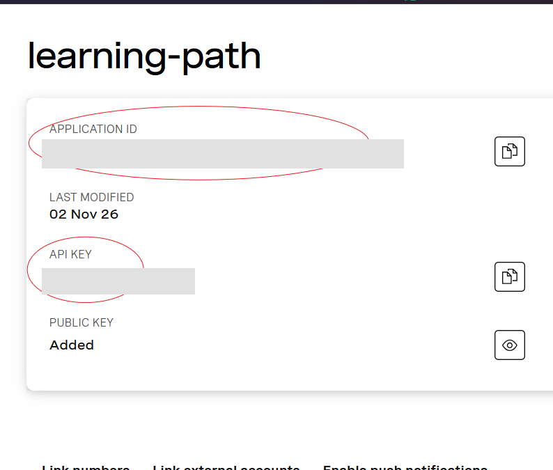

# Vonage MCP and CLI setup

This guide covers local developer tools for issue #27, not the application runtime. Each teammate configures them on her own machine with her own Vonage account. Never share or commit credentials.

The API key and secret are account-level credentials. The key/secret from your training demo belong to the account you used there; they are not team credentials. A future project account will have its own. Neither tool loads credentials from the project's `.env`; configure each one as described below.

Both tools need Node.js 22 LTS or later ([ADR 005](../adr/005-pin-initial-runtime-and-tooling-versions.md)); `@vonage/auth@1.19.1` declares `"engines": { "node": ">=22" }`, so Node 20 is not supported.

## 1. Configure the Vonage MCP server

There is no universal MCP config file. Each client keeps its own. The server, its two pinned packages, and the environment variables are the same everywhere; only `npx` versus `npx.cmd` and the client's syntax change.

| Client | Personal configuration file | Format |
| --- | --- | --- |
| GitHub Copilot CLI | `~/.copilot/mcp-config.json` (`COPILOT_HOME` overrides the directory) | JSON, top-level `mcpServers` |
| VS Code with Copilot | VS Code's own MCP configuration (user or workspace); not `~/.copilot/mcp-config.json` | JSON, VS Code MCP format |
| Claude Code | `~/.claude.json`, written by `claude mcp add --scope user` | JSON, `mcpServers` entry |
| Codex | `~/.codex/config.toml` | TOML, `[mcp_servers.<name>]` table |
| OpenCode | `~/.config/opencode/opencode.json` | JSON, `mcp.servers` |

Do not add a repository-root `.mcp.json`, `.vscode/mcp.json`, `.codex/config.toml`, or any other project-scoped MCP file. Claude Code and Codex CLI both offer project scope and VS Code offers a workspace file, but MCP configuration stays personal here so credentials never reach source control. For an unlisted client, use its own setup flow with the same entry; see Vonage's [Tooling MCP installation guide](https://developer.vonage.com/en/mcp-server/how-to-guides/install-tooling-mcp-server).

### The server entry

The server package, the pinned packages, and the `env` block are the same for every client; only `npx` versus `npx.cmd` and each client's own syntax change. Fill in your account key and secret; keep the other values empty.

```json
{
  "vonage-mcp-server-api-bindings": {
    "type": "stdio",
    "command": "npx",
    "args": [
      "--yes",
      "--package=@vonage/auth@1.19.1",
      "--package=@vonage/vonage-mcp-server-api-bindings@1.5.1",
      "--",
      "vonage-mcp-server-api-bindings"
    ],
    "env": {
      "VONAGE_APPLICATION_ID": "",
      "VONAGE_PRIVATE_KEY64": "",
      "VONAGE_API_KEY": "<YOUR_VONAGE_API_KEY>",
      "VONAGE_API_SECRET": "<YOUR_VONAGE_API_SECRET>",
      "VONAGE_VIRTUAL_NUMBER": "",
      "VONAGE_WHATSAPP_NUMBER": ""
    }
  }
}
```

Both packages must be named: the single-package form (`npx -y @vonage/vonage-mcp-server-api-bindings`) ran in Copilot CLI and OpenCode on Windows on 2026-11-16, but failed in Codex Desktop and Claude Code with `ERR_MODULE_NOT_FOUND: Cannot find package auth`. Copilot CLI and OpenCode have not been re-run with this pinned form.

Only the key and secret are needed for the balance check; the other fields remain for tools that may need them later:

- `VONAGE_APPLICATION_ID` and `VONAGE_PRIVATE_KEY64` belong to a Vonage Application. The `private.key` in your `vonage` folder is from the training demo, not a Restaurant Receptionist app: leave both blank and do not reuse that pair. If the team creates an application, its ID and key will be agreed then.
- `VONAGE_VIRTUAL_NUMBER` and `VONAGE_WHATSAPP_NUMBER` are not needed here. RCS is outside the MVP, so there is no RCS variable.

The screenshots show where these values appear in the Dashboard; the application shown is an example, not the team's app.




Keep the secret only in your personal config. If one is exposed, create a replacement, update the tools that use it, then revoke the exposed secret in the Dashboard.

### GitHub Copilot CLI

`~/.copilot/mcp-config.json` (Windows: `%USERPROFILE%\.copilot\mcp-config.json`) with a top-level `mcpServers` object. This file is the personal configuration for GitHub Copilot CLI; it is not the configuration for Copilot in VS Code. The Windows check used the single-package form; the pinned form above has not been tried in Copilot CLI.

**Windows PowerShell**

```powershell
$directory = Join-Path $HOME ".copilot"
$file = Join-Path $directory "mcp-config.json"
New-Item -ItemType Directory -Force $directory | Out-Null
if (-not (Test-Path $file)) {
  Set-Content -Path $file -Value '{"mcpServers":{}}' -Encoding ASCII
}
notepad $file
```

**macOS Terminal**

```bash
mkdir -p "$HOME/.copilot"
[ -f "$HOME/.copilot/mcp-config.json" ] || printf '{"mcpServers":{}}\n' > "$HOME/.copilot/mcp-config.json"
open -e "$HOME/.copilot/mcp-config.json"
```

Preserve any other servers already in the file and add the entry above inside `mcpServers`.

### VS Code with Copilot (unverified)

`~/.copilot/mcp-config.json` is the personal configuration for GitHub Copilot CLI, not for Copilot in VS Code. These steps were followed by a teammate using the Copilot harness inside VS Code chat; they configure that harness (which writes to `~/.copilot/mcp-config.json`) and are not the same as VS Code's own editor-native MCP configuration. The subsection is otherwise unverified: nobody else on the team has reproduced it, and it has not been checked against VS Code's current release.

1. Select the **Copilot** harness in a chat session.
2. Run **Chat: Open Customizations**, then select **MCP Servers**.
3. Select **Add Server**, choose the stdio transport, and enter `npx` with `--yes --package=@vonage/auth@1.19.1 --package=@vonage/vonage-mcp-server-api-bindings@1.5.1 -- vonage-mcp-server-api-bindings`.
4. Choose **Global** > **Copilot Global** as the destination.

For VS Code's own (editor-native) MCP setup, follow the official VS Code instructions instead: https://code.visualstudio.com/docs/copilot/chat/mcp-servers. Keep the server entry identical to the one above (same command, args, and env) and store credentials in your personal VS Code configuration, never in a workspace `.vscode/mcp.json` that could reach source control.

### Claude Code

Use user scope: no `.mcp.json` is created at the repository root, which this project does not allow.

**Windows PowerShell**

```powershell
$apiKey = Read-Host "Vonage API key"
$secure = Read-Host "Vonage API secret" -AsSecureString
$apiSecret = [System.Net.NetworkCredential]::new("", $secure).Password

claude mcp add -e "VONAGE_API_KEY=$apiKey" -e "VONAGE_API_SECRET=$apiSecret" --scope user --transport stdio vonage -- cmd /c npx --yes --package=@vonage/auth@1.19.1 --package=@vonage/vonage-mcp-server-api-bindings@1.5.1 -- vonage-mcp-server-api-bindings

Remove-Variable apiKey, apiSecret, secure
```

Native Windows needs `cmd /c` in front of `npx` (Claude Code's own MCP documentation). macOS is untested: use the same command without `cmd /c`. `-e` takes several values, so it must not come directly before the server name; another option after the last `-e` separates them. Without it the command fails with `Invalid environment variable format: vonage`.

Values read with `Read-Host` keep the secret out of shell history; a literal `-e "VONAGE_API_SECRET=..."` does not. The entry is stored in the user-level `~/.claude.json`. To avoid passing the secret as an argument at all, add the `env` block above under `mcpServers.vonage` in `~/.claude.json` instead; `${NAME}` references are expanded there.

```shell
claude mcp list
```

It prints a status per server, such as `Connected` or `Failed to connect`; `claude mcp get vonage` shows the detail.

#### Keep Claude Code read-only

Version 1.5.1 exposes 15 tools. Claude Code has no `enabled_tools` equivalent, and `deny` always wins over `allow`, so the OpenCode pattern does not apply. Deny the tools that send messages, place calls, change the account, or write files, in user-level `~/.claude/settings.json`:

```json
{
  "permissions": {
    "deny": [
      "mcp__vonage__SMS",
      "mcp__vonage__whatsapp-send-text",
      "mcp__vonage__whatsapp-send-text-with-sms-failover",
      "mcp__vonage__rcs-send-text",
      "mcp__vonage__rcs-send-text-with-sms-failover",
      "mcp__vonage__outbound-voice-message",
      "mcp__vonage__create-application",
      "mcp__vonage__link-number-to-vonage-application",
      "mcp__vonage__save-chart"
    ]
  }
}
```

Restart Claude Code and check that the denied tools no longer appear in the agent's tool list; that is how the rules were verified. A malformed rule, such as two names in one string, is accepted silently and matches nothing. The remaining tools ask for permission on each call.

### Codex

Codex reads `~/.codex/config.toml`. Add this table:

```toml
[mcp_servers.vonage]
command = "npx.cmd"
args = [
  "--yes",
  "--package=@vonage/auth@1.19.1",
  "--package=@vonage/vonage-mcp-server-api-bindings@1.5.1",
  "--",
  "vonage-mcp-server-api-bindings",
]
startup_timeout_sec = 60
enabled_tools = [
  "balance"
]

[mcp_servers.vonage.env]
VONAGE_APPLICATION_ID = ""
VONAGE_PRIVATE_KEY64 = ""
VONAGE_API_KEY = "<YOUR_VONAGE_API_KEY>"
VONAGE_API_SECRET = "<YOUR_VONAGE_API_SECRET>"
VONAGE_VIRTUAL_NUMBER = ""
VONAGE_WHATSAPP_NUMBER = ""
```

This block was run on Windows in the Codex desktop app; the Codex CLI and macOS were not verified. On macOS use `command = "npx"`; that variant is untested. `startup_timeout_sec = 60` replaces the 10-second default, which is short for a cold `npx` run. `enabled_tools` keeps the exposed set read-only; add the other read-only tools listed under OpenCode if you need them, since only `balance` was exercised through Codex. Use `~/.codex/config.toml`, not a project-scoped `.codex/config.toml`, and keep the file private: it holds the secret.

### OpenCode

Global config at `~/.config/opencode/opencode.json`. OpenCode uses a `command` array and an `environment` object:

```jsonc
{
  "$schema": "https://opencode.ai/config.json",
  "mcp": {
    "servers": {
      "vonage": {
        "type": "local",
        "command": ["npx", "--yes", "--package=@vonage/auth@1.19.1", "--package=@vonage/vonage-mcp-server-api-bindings@1.5.1", "--", "vonage-mcp-server-api-bindings"],
        "environment": {
          "VONAGE_APPLICATION_ID": "",
          "VONAGE_PRIVATE_KEY64": "",
          "VONAGE_API_KEY": "<YOUR_VONAGE_API_KEY>",
          "VONAGE_API_SECRET": "<YOUR_VONAGE_API_SECRET>",
          "VONAGE_VIRTUAL_NUMBER": "",
          "VONAGE_WHATSAPP_NUMBER": ""
        }
      }
    }
  }
}
```

The OpenCode check in the validation status used the single-package form; this pinned form has not been run in OpenCode.

The block below is optional and keeps the agent read-only. Rules are ordered and the last match wins, so a catch-all `deny` plus explicit `allow` rules also deny tools added by a future server version:

```jsonc
{
  "permissions": [
    { "action": "vonage_*", "resource": "*", "effect": "deny" },
    { "action": "vonage_balance", "resource": "*", "effect": "allow" },
    { "action": "vonage_list-applications", "resource": "*", "effect": "allow" },
    { "action": "vonage_list-purchased-numbers", "resource": "*", "effect": "allow" },
    { "action": "vonage_get-records-report", "resource": "*", "effect": "allow" },
    { "action": "vonage_make-chart", "resource": "*", "effect": "allow" }
  ]
}
```

In OpenCode 2.3.2 (the version tested here) the permission action names keep the hyphens of the underlying tool names, so the allow rules above use hyphens and leave all five read-only tools reachable. `vonage_balance` needs no change because it contains no hyphen.

Note on version differences: OpenCode's documentation and issue #63555 describe the action names as normalized (unsupported characters become underscores), and PR #63881 changes the core to do that normalization. In a version where that fix is active, the rules above must be rewritten with underscores (`vonage_list_applications`, etc.); with hyphens they would stop matching and the catch-all `deny` would hide the tools. If you upgrade OpenCode and the read-only tools disappear, switch the four rules above to underscores and re-check.

## 2. Check the MCP connection

Save the config and start or restart your client. Ask it:

> Use the Vonage MCP server to check my account balance.

The agent should call the `balance` tool. Only that visible tool call verifies the connection: `vonage balance` below checks the CLI only, and a Dashboard balance view proves nothing about MCP.

| Client | Command |
| --- | --- |
| OpenCode | `opencode mcp list` |
| Claude Code | `claude mcp list` |

Codex shows connection state in the app's own interface; the `balance` tool call is the verification. VS Code is unverified here.

## 3. Configure and check the Vonage CLI

The CLI is a separate required setup in issue #27 and does not read the MCP config. Configure it with your own account key and secret.

```shell
npm install -g @vonage/cli
```

The Windows check used Node 22.18.0, npm 10.9.3, and `@vonage/cli@3.3.1`. The install printed `EBADENGINE` warnings for Prism dependencies that declare Node 24.18.0; `vonage auth set` and `vonage balance` still succeeded.

`vonage auth set` accepts `--api-secret` as a documented option (Vonage's [CLI guide](https://developer.vonage.com/en/vonage-cli/getting-started)). The prompts below hide the secret while you type and keep it out of shell history, but it is passed as a process argument and may be visible to local process-inspection tools. Run this only on your trusted personal computer, and do not record the session.

**Windows PowerShell**

```powershell
$apiKey = Read-Host "Vonage API key"
$apiSecretSecure = Read-Host "Vonage API secret" -AsSecureString
$apiSecret = [System.Net.NetworkCredential]::new("", $apiSecretSecure).Password
vonage auth set --api-key $apiKey --api-secret $apiSecret
Remove-Variable apiKey, apiSecretSecure, apiSecret
```

**macOS Terminal**

```bash
printf "Vonage API key: "
IFS= read -r apiKey
printf "Vonage API secret: "
IFS= read -r -s apiSecret
printf '\n'
vonage auth set --api-key "$apiKey" --api-secret "$apiSecret"
unset apiKey apiSecret
```

```shell
vonage balance
```

This read-only command confirms the CLI credentials and shows your personal balance; do not share its output. Exit code `0` means it succeeded.

Precedence: command-line flags, then a `.vonagerc` in the working directory, then the global config (`%USERPROFILE%\.vonage\config.json` on Windows, `~/.vonage/config.json` on macOS). A project-local `.vonagerc` therefore overrides global values; do not create or commit one here.

If `vonage auth set` reports **Invalid API Key or Secret**, confirm that the key and the active secret belong to the same API Key entry in Dashboard > API Settings. Credentials are checked before `auth set` commits them. If the first configuration fails, no config is created and `vonage balance` reports that none was found; a failed change leaves an existing config unchanged.

## Remove saved credentials if you stop using the tools

- Remove only the Vonage server entry from your personal agent config, preserving other servers. Use the client command when it exists, such as `claude mcp remove vonage --scope user`.
- Delete the CLI config file only if you no longer need any Vonage CLI configuration. That removes saved credentials; it does not uninstall the CLI.

## Scope of the checks

Issue #27 authorizes read-only balance checks and excludes application or number changes, SMS sends, and calls. None were used and no credit-consuming operation was performed.

`search-available-numbers` only lists numbers available for purchase, so it is read-only as well. `save-chart` writes a file locally and stays out of the read-only set; `make-chart` stays in.

Read-only is the scope of this setup, not of the product: the application will request SMS confirmations through the Messages API after persistence, using its own Vonage Application credentials in the backend rather than these developer tools. RCS and RCS-to-SMS fallback stay outside the MVP.

## Validation status

- CLI `@vonage/cli@3.3.1` with Node 22.18.0 and npm 10.9.3 on Windows; a second participant (the reviewer) reproduced `vonage auth set` and `vonage balance` with her own account, and the `EBADENGINE` warnings for Prism dependencies did not block them.
- Copilot CLI on Windows: the `balance` tool call succeeded with the single-package command (2026-11-16); do not share the returned balance.
- Codex desktop app on Windows: the reviewer's own account, with the pinned two-package command, `balance` succeeded. This is the second-person verification for #27.
- Claude Code `2.1.330` on native Windows with Node 22.23.5 and npm 10.9.9: the `cmd /c` command with the pinned packages above, `claude mcp list` reported `Connected`, the `balance` call succeeded, and the nine denied tools disappeared from the tool list; output not shared.
- OpenCode `2.3.2` on Windows, using the single-package command: `opencode mcp list` reported `connected`, a native `balance` call succeeded, and all five read-only tools stayed reachable with the hyphenated allow rules in section 1. A hyphenated read-only tool (`list-applications`) was invoked successfully without recording its output. Switching those rules to underscores removed `list-applications` and `list-purchased-numbers`, so the guide keeps hyphens for this version (see the note in section 1).
- The VS Code subsection comes from official documentation on 2026-11-19 and has not been run. Codex CLI and macOS are unverified.
